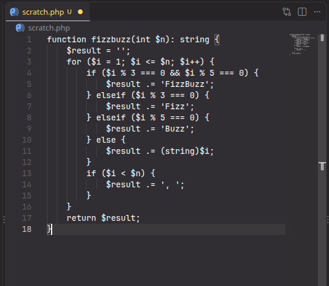

# Lab 0 submission

## Copilot suggestion screenshot

## What the app does

LinkKeeper is a small Laravel 13 bookmark manager. It's the starter app for Modules 0–3 of an AI-augmented development course. Bookmarks have a title, URL, optional visited_at and a pinned flag, and there's also a tag system. There's no JavaScript build, and /bookmarks lists the 30 seeded bookmarks. The repo also contains an autograder for student submissions, which scores a SUBMISSION.md file.

Key files:

- App code: app/Http/Controllers/BookmarkController.php, app/Models/Bookmark.php, app/Models/Tag.php, app/Services/TagNormalizer.php
- Routing and view: routes/web.php, resources/views/bookmarks/index.blade.php
- Database: database/migrations/ (bookmarks and tags tables), database/seeders/
- Tests: tests/Feature/, tests/Unit/TagNormalizerTest.php
- Grading: grading/score.py, grading/GradingHelpers.php, grading/weights.json, grading/submission-headings.json, and the per-module tests in grading/tests/, run by .github/workflows/grade.yml

I only skimmed the README and the file listing, so this is a summary rather than a code review.

## Oddity found

BookmarkController::index and the view subtitle claim "pinned first, newest-first" but sort both columns ascending (unpinned and oldest first), the Bookmark docblock claims visited_at is never null when the column is nullable and 3 seeded rows are null, the README's "2 passing" tests is stale (there are 4).
